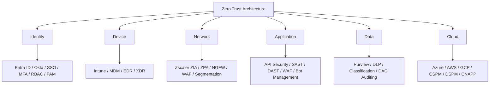

# Shakil Md. Rezwanul Bari

### Senior Cyber Security Architect / Engineer
**Architecture Governance | Zero Trust | Cloud | Identity | Data Security**

[](https://www.linkedin.com/in/rezwanulbari)
[](https://www.linkedin.com/in/rezwanulbari)
[](https://github.com/mrezwanulbari)
[](https://github.com/mrezwanulbari#certifications)


---

## whoami

```
$ whoami
Shakil Md. Rezwanul Bari - Senior Cyber Security Architect / Engineer

$ focus
Zero Trust architecture, governed by design, proven in regulated
financial services and enterprise cloud environments.
```

> I design security before it becomes an incident response problem: architecture reviews, standards and roadmaps that turn NIST, ISO 27001 and SOC 2 requirements into controls engineers can actually build, operate and audit.

- **Senior Cyber Security Architect / Engineer** at Aspire Tech Services and Solutions Corp., New York, since December 2023
- **15+ years in cybersecurity**, with earlier experience in IT operations and teaching from 2004
- **Based in Queens, New York**
- **MSc in Management Information Systems** - Daffodil International University
- **BSc (Hons) in Computer and Information Systems** - London Metropolitan University, UK

---

## Highlights

| Result | Where it came from |
| --- | --- |
| **15+ years** in cybersecurity architecture and engineering | Financial services, enterprise and cloud environments |
| **21 professional certifications** | Governance, audit, cloud, Azure, AWS, Splunk and CompTIA |
| **60+ SOAR playbooks** built | Phishing, malware and insider threat use cases |
| **45% reduction** in MTTD and MTTR | Automated detection and response playbooks |
| **60% faster response, 40% fewer false positives** | Splunk and Cortex XSOAR tuning aligned to MITRE ATT&CK |
| **1,500+ endpoints** protected | Enterprise endpoint deployment and EDR operations |
| **80% of malicious traffic blocked** at the web application edge | Palo Alto and F5 WAF deployment |
| **PCI DSS v4.0.1 project: 80% security enhancement** | Regulated banking environment |

---

## Certifications

Certification is a core part of this profile, not an afterthought. The full set, grouped by discipline:

### Governance, Audit and Risk

| Certification |
| --- |
| CISM - Certified Information Security Manager |
| CISA - Certified Information Systems Auditor |
| ISO 27001 Lead Auditor |
| ISO 22301 Lead Implementer |
| ITIL v3 |

### Cloud Architecture

| Certification |
| --- |
| AWS Certified Solutions Architect - Associate |
| AWS Certified Cloud Practitioner |
| Microsoft Certified: Azure Cybersecurity Architect Expert (SC-100) |
| Microsoft Certified: Azure Security Engineer Associate (AZ-500) |
| Microsoft Certified: Azure Administrator Associate (AZ-104) |

### Microsoft and Infrastructure

| Certification |
| --- |
| MCSA - Microsoft Certified Solutions Associate |
| MCITP - Microsoft Certified IT Professional |
| MCTS - Microsoft Certified Technology Specialist |

### Security Operations and Analysis

| Certification |
| --- |
| CEH - Certified Ethical Hacker |
| CompTIA Security+ |
| CompTIA CySA+ |
| CompTIA CSAP |

### Splunk

| Certification |
| --- |
| Splunk Enterprise Security Certified Admin |
| Splunk Certified Cybersecurity Defense Analyst |
| Splunk Cloud Certified Admin |
| Splunk Core Certified Power User |

---

## The architecture map

Zero Trust is not a single product. It is a set of controls across every layer, continuously verified:



**Frameworks applied in practice:** NIST 800-53, NIST 800-207, CIS Controls, ISO 27001, SOC 2, PCI DSS, GLBA, SOX, CMMC, MITRE ATT&CK and MITRE D3FEND.

---

## The arsenal

### Architecture and Governance

Enterprise security architecture, security-by-design, architecture and design reviews, Zero Trust roadmaps and maturity models, risk and gap analysis, governance documentation, KPI reporting and executive briefings.

### Zero Trust and Network

Zscaler ZIA and ZPA, Prisma Access, Palo Alto Networks and Panorama, Cisco, Fortinet, Check Point, F5, Imperva, AWS WAF, Cloudflare, Akamai Kona Site Defender, Cisco Meraki, secure web gateways and micro-segmentation.

### Identity and Access

Microsoft Entra ID (Azure AD), Active Directory, Okta, SSO, MFA, RBAC, IGA, PAM with CyberArk and Delinea, Managed Identities, OAuth2, JWT and mTLS, Conditional Access.

### Microsoft Security

Defender for Endpoint and Cloud, Microsoft Sentinel, Microsoft Purview, Intune and MDM, Azure Security Center, Azure API Management, KQL.

### Cloud Security

Azure, AWS (IAM, GuardDuty, S3 security, WAF) and Google Cloud (IAM, VPC Service Controls, Security Command Center, Chronicle). Wiz, Prisma Cloud, CSPM and DSPM, Kubernetes security and container image scanning.

### Endpoint, SIEM, SOAR and Incident Response

CrowdStrike Falcon, Microsoft Defender, SentinelOne, Sophos Intercept X, Trend Micro, Trellix and Cortex XDR. Splunk, Microsoft Sentinel, QRadar, Cortex XSOAR and Splunk SOAR. Detection engineering with SPL, KQL, Sigma and YARA, threat hunting, forensics and threat intelligence enrichment.

### Vulnerability Management and Automation

Qualys, Tenable Nessus and Tenable.io, Rapid7, OpenVAS, Burp Suite, OWASP ZAP and Metasploit. Python, PowerShell, Bash and JavaScript for SOAR workflows and compliance automation.

### Data and Email Protection

Microsoft Purview, Google Workspace DLP, Forcepoint, Symantec, Proofpoint and Trellix. Mimecast, Microsoft EOP and Cisco SEG, data classification and labelling.

---

## Featured work - Zero Trust Architecture

> **[zero-trust-architecture](https://github.com/mrezwanulbari/zero-trust-architecture)**

Zero Trust security framework implementation guides, NIST 800-207 mappings and architecture patterns for enterprise environments.

```
Identity - Device - Network - Application - Data - Cloud
   |          |         |           |           |        |
Least     Verified   Segmented   Hardened    Classified  Governed
privilege  access     traffic     APIs        data        posture
```

This is the reference point for the rest of the repositories below: the architecture comes first, then detection, response and cloud controls are built to fit it.

---

## More projects

| Project | What it does | Focus |
| --- | --- | --- |
| **[MITRE-ATT-CK-Threat-Defense-Framework](https://github.com/mrezwanulbari/MITRE-ATT-CK-Threat-Defense-Framework)** | Proactive threat hunting, detection engineering and adversary behaviour analysis | MITRE ATT&CK, Python |
| **[siem-soar-detection-engineering](https://github.com/mrezwanulbari/siem-soar-detection-engineering)** | Detection-as-code and SOAR automation reference | Sigma, SOAR playbooks |
| **[incident-response-playbooks](https://github.com/mrezwanulbari/incident-response-playbooks)** | Standardised incident response procedures and runbooks for SOC teams | NIST 800-61, SOC operations |
| **[cybersecurity-architecture-frameworks](https://github.com/mrezwanulbari/cybersecurity-architecture-frameworks)** | Enterprise architecture reference for Zero Trust, cloud and governance | NIST, CISA-aligned design |
| **[cybersecurity-defense-frameworks](https://github.com/mrezwanulbari/cybersecurity-defense-frameworks)** | Defence-in-depth reference with YARA and Sigma templates | YARA, Sigma, SOC |
| **[ransomware-defense-framework](https://github.com/mrezwanulbari/ransomware-defense-framework)** | Ransomware prevention, detection and response framework | CISA-aligned |
| **[digital-forensics-dfir-toolkit](https://github.com/mrezwanulbari/digital-forensics-dfir-toolkit)** | DFIR reference: evidence handling, memory and disk forensics, chain of custody | DFIR, Python |
| **[Enterprise-Splunk-Deployment-Automation](https://github.com/mrezwanulbari/Enterprise-Splunk-Deployment-Automation)** | Enterprise Splunk Deployment Server architecture and best practices | Splunk, Python |
| **[Splunk-ITSI-Predictive-Monitoring-Engine](https://github.com/mrezwanulbari/Splunk-ITSI-Predictive-Monitoring-Engine)** | Splunk ITSI configurations, KPI definitions and service monitoring | Splunk ITSI, Python |
| **[aws-security](https://github.com/mrezwanulbari/aws-security)** | AWS cloud security architectures, IAM, GuardDuty and best practices | AWS, Python |
| **[azure-security](https://github.com/mrezwanulbari/azure-security)** | Azure security frameworks, Sentinel integration, Defender and compliance automation | Azure, Sentinel |
| **[security-training-curriculum](https://github.com/mrezwanulbari/security-training-curriculum)** | Training materials, lab exercises and workforce development resources | Training, labs |
| **[cybersecurity-research-papers](https://github.com/mrezwanulbari/cybersecurity-research-papers)** | Original cybersecurity research, analysis and publications | Research |
| **[rezwanulbari](https://github.com/mrezwanulbari/rezwanulbari)** | Portfolio and small contributions to help others in cybersecurity | HTML, community |

---

## Experience

| Period | Role | Organisation |
| --- | --- | --- |
| Dec 2023 - Present | Cyber Security Engineer | Aspire Tech Services and Solutions Corp., New York |
| Apr 2021 - Nov 2023 | Cyber Security Analyst, Senior Executive Officer | Bank Asia PLC, Bangladesh and BA Express, New York |
| Feb 2011 - Mar 2021 | Lead Cyber Security Engineer, Principal Officer | NCC Bank PLC, Bangladesh |
| May 2006 - Feb 2011 | IT Support Coordinator | Mennonite Central Committee, Bangladesh |
| Feb 2004 - Apr 2006 | Lecturer | Daffodil Institute of IT, Bangladesh |

**At Aspire, current work includes:** Zero Trust design across identity, device, network, application and data; Zscaler ZIA and ZPA roadmaps; Palo Alto firewall policy and micro-segmentation; Cloudflare and Akamai edge security; Netwrix data access governance; cloud security across Azure, AWS and GCP with Wiz, Prisma CNAPP and Defender for Cloud; identity security with Entra ID, Okta and PAM; and AI governance aligned to the NIST AI Risk Management Framework.

---

## What I am about

- **Architecture before tooling.** A control that does not fit the architecture will not survive an audit or an incident.
- **Least privilege, continuously verified.** Access is granted for a reason, monitored for risk, and removed when it is no longer needed.
- **Governance that engineers can use.** Standards, runbooks and KPIs are only useful if teams can build to them and auditors can verify them.
- **Detection tuned for signal.** Fewer false positives, faster triage, and playbooks that hold up at 2 a.m. as well as in a review meeting.
- **Mentoring the SOC.** Analysts get better when playbooks, detection logic and incident lessons are shared, not kept in one person's head.

---

## Connect

- **LinkedIn:** [linkedin.com/in/rezwanulbari](https://www.linkedin.com/in/rezwanulbari)
- **GitHub:** [github.com/mrezwanulbari](https://github.com/mrezwanulbari)
- **Location:** Queens, New York

---


> Security architecture is a governance discipline first, and a technology discipline second. Get the governance right, and the technology has a chance to work.
