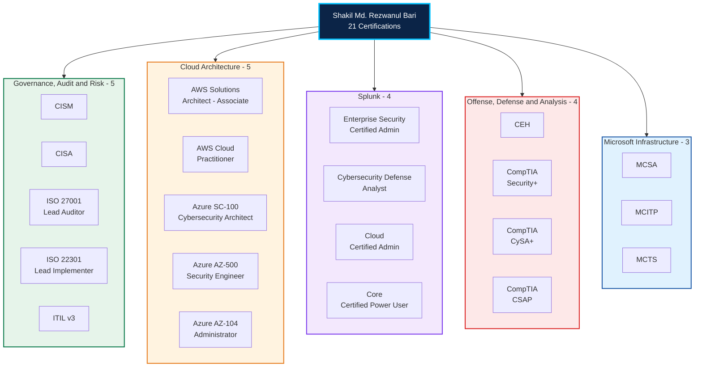
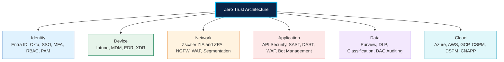
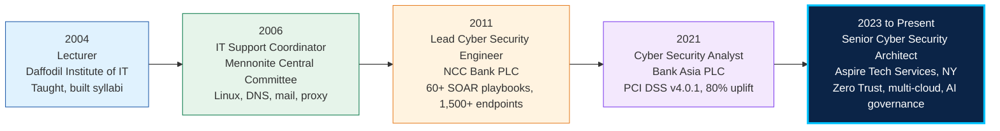

<div align="center">


[](https://github.com/mrezwanulbari)

[](https://www.linkedin.com/in/rezwanulbari)
[](https://github.com/mrezwanulbari)
[](https://www.linkedin.com/in/rezwanulbari)


</div>

---

<div align="center">

### I design security before it becomes an incident response problem.

Architecture reviews, standards and roadmaps that turn NIST, ISO 27001 and SOC 2 into controls engineers can build, operate and audit.

</div>

<div align="center">

| | | | |
| :---: | :---: | :---: | :---: |
| **15+** | **21** | **60+** | **45%** |
| Years in security | Certifications | SOAR playbooks built | Cut in MTTD and MTTR |
| **1,500+** | **80%** | **60%** | **40%** |
| Endpoints protected | Malicious traffic blocked at the edge | Faster response with SOAR tuning | Fewer false positives |

</div>

---

## 🧠 The Certification Brain

This is the centrepiece. Every certification is its own node, colour coded by discipline, exactly like an Obsidian graph. No cert hidden in a paragraph.



### Certification wall, at a glance

**🟢 Governance and Audit:**     

**🟠 Cloud:**     

**🟣 Splunk:**    

**🔴 Operations:**    

**🔵 Microsoft:**   

---

## 🛡️ Zero Trust, in one picture

Not a product. A control set across every layer, continuously verified:



**Frameworks applied:** NIST 800-53, NIST 800-207, CIS, ISO 27001, SOC 2, PCI DSS, GLBA, SOX, CMMC, MITRE ATT&CK, MITRE D3FEND.

---

## 📈 The Experience Journey

Seniority rising, left to right. Each stop is a role plus the proof from that role.



**Current work at Aspire:** Zero Trust across identity, device, network, application and data. Zscaler ZIA and ZPA roadmaps. Palo Alto policy and micro-segmentation. Cloudflare and Akamai edge security. Netwrix data access governance. Cloud security across Azure, AWS and GCP with Wiz, Prisma CNAPP and Defender for Cloud. Identity with Entra ID, Okta and PAM. AI governance aligned to the NIST AI Risk Management Framework.

**Education:** MSc Management Information Systems, Daffodil International University. BSc (Hons) Computer and Information Systems, London Metropolitan University, UK.

---

## ⚡ Featured Work

### 🛡️ [zero-trust-architecture](https://github.com/mrezwanulbari/zero-trust-architecture)

Zero Trust implementation guides, NIST 800-207 mappings and architecture patterns for enterprise environments. This is the reference point for everything below: architecture first, then detection, response and cloud controls built to fit it.

```
Identity - Device - Network - Application - Data - Cloud
Least privilege, verified access, segmented traffic,
hardened APIs, classified data, governed posture.
```

---

## 🔥 More Projects

| Project | What it does |
| --- | --- |
| 🔍 **[MITRE-ATT-CK-Threat-Defense-Framework](https://github.com/mrezwanulbari/MITRE-ATT-CK-Threat-Defense-Framework)** | Threat hunting, detection engineering, adversary behaviour analysis |
| ⚡ **[siem-soar-detection-engineering](https://github.com/mrezwanulbari/siem-soar-detection-engineering)** | Detection-as-code, Sigma rules, SOAR automation playbooks |
| 🚨 **[incident-response-playbooks](https://github.com/mrezwanulbari/incident-response-playbooks)** | Standardised IR procedures and runbooks for SOC teams |
| 🏛️ **[cybersecurity-architecture-frameworks](https://github.com/mrezwanulbari/cybersecurity-architecture-frameworks)** | Enterprise architecture reference, Zero Trust, cloud, governance |
| 🛡️ **[cybersecurity-defense-frameworks](https://github.com/mrezwanulbari/cybersecurity-defense-frameworks)** | Defence-in-depth, YARA and Sigma templates |
| 🔒 **[ransomware-defense-framework](https://github.com/mrezwanulbari/ransomware-defense-framework)** | Ransomware prevention, detection and response, CISA-aligned |
| 🔬 **[digital-forensics-dfir-toolkit](https://github.com/mrezwanulbari/digital-forensics-dfir-toolkit)** | DFIR: evidence handling, memory and disk forensics, chain of custody |
| 📊 **[Enterprise-Splunk-Deployment-Automation](https://github.com/mrezwanulbari/Enterprise-Splunk-Deployment-Automation)** | Enterprise Splunk Deployment Server architecture and best practices |
| 📈 **[Splunk-ITSI-Predictive-Monitoring-Engine](https://github.com/mrezwanulbari/Splunk-ITSI-Predictive-Monitoring-Engine)** | Splunk ITSI, KPI definitions, service monitoring |
| ☁️ **[aws-security](https://github.com/mrezwanulbari/aws-security)** | AWS security, IAM, GuardDuty, best practices |
| 🔷 **[azure-security](https://github.com/mrezwanulbari/azure-security)** | Azure security, Sentinel, Defender, compliance automation |
| 🎓 **[security-training-curriculum](https://github.com/mrezwanulbari/security-training-curriculum)** | Training materials, labs, workforce development |
| 📚 **[cybersecurity-research-papers](https://github.com/mrezwanulbari/cybersecurity-research-papers)** | Original research, analysis and publications |
| 🌐 **[rezwanulbari](https://github.com/mrezwanulbari/rezwanulbari)** | Portfolio and small contributions to help others in cybersecurity |

---

## 🧰 The Arsenal

<div align="center">


</div>

**How I work:** Architecture before tooling. Least privilege, continuously verified. Governance that engineers can use. Detection tuned for signal, not noise. Playbooks that hold up at 2 a.m. as well as in a review meeting. Mentoring the SOC, not hoarding knowledge.

---

<div align="center">

## 🤝 Connect

[](https://www.linkedin.com/in/rezwanulbari)
[](https://github.com/mrezwanulbari)


> Security architecture is a governance discipline first, and a technology discipline second. Get the governance right, and the technology has a chance to work.

</div>


