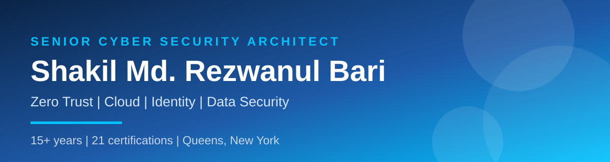
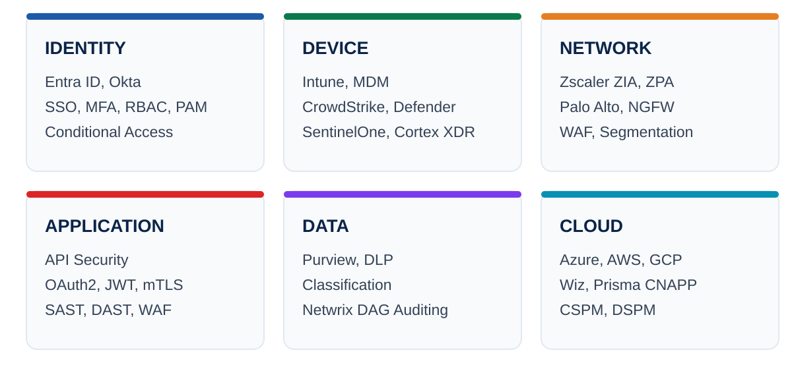
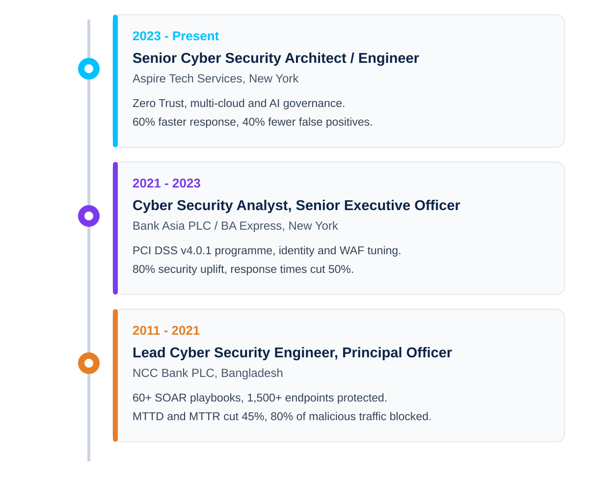

<div align="center">

[](https://www.linkedin.com/in/rezwanulbari)
[](https://github.com/mrezwanulbari)
[](https://www.linkedin.com/in/rezwanulbari)

</div>

---

## whoami

```
$ whoami
Shakil Md. Rezwanul Bari - Senior Cyber Security Architect / Engineer

$ focus
Zero Trust architecture, governed by design, proven in regulated
financial services and enterprise cloud environments.
```

> I design security before it becomes an incident response problem: architecture reviews, standards and roadmaps that turn NIST, ISO 27001 and SOC 2 into controls engineers can build, operate and audit.

- **Senior Cyber Security Engineer** at Aspire Tech Services and Solutions Corp., New York, since December 2023
- **15+ years in cybersecurity**, with earlier IT operations and teaching experience from 2004
- **Based in Queens, New York**
- **MSc Management Information Systems** - Daffodil International University
- **BSc (Hons) Computer and Information Systems** - London Metropolitan University, UK

---

## Highlights

| 15+ years | 21 certifications | 60+ SOAR playbooks | 45% cut in MTTD and MTTR |
| :---: | :---: | :---: | :---: |
| In cybersecurity | Across governance, cloud, Splunk, operations and Microsoft | For phishing, malware and insider threat | From automated detection and response |

| 1,500+ endpoints | 80% malicious traffic blocked | 60% faster response | 40% fewer false positives |
| :---: | :---: | :---: | :---: |
| Protected with enterprise EDR | At the web edge with Palo Alto and F5 WAF | With Splunk and Cortex XSOAR tuning | With MITRE ATT&CK-aligned tuning |

---

## The certification brain

Every certification is a node in this map, colour coded by discipline. The full list is written out below it, so the detail is readable even without the image.


### Full list, by discipline

| Discipline | Certifications |
| --- | --- |
| Governance, Audit and Risk | CISM, CISA, ISO 27001 Lead Auditor, ISO 22301 Lead Implementer, ITIL v3 |
| Cloud Architecture | AWS Certified Solutions Architect - Associate, AWS Certified Cloud Practitioner, Azure Cybersecurity Architect Expert (SC-100), Azure Security Engineer Associate (AZ-500), Azure Administrator Associate (AZ-104) |
| Splunk | Splunk Enterprise Security Certified Admin, Splunk Certified Cybersecurity Defense Analyst, Splunk Cloud Certified Admin, Splunk Core Certified Power User |
| Operations and Analysis | CEH, CompTIA Security+, CompTIA CySA+, CompTIA CSAP |
| Microsoft Infrastructure | MCSA, MCITP, MCTS |

**Governance:**     

**Cloud:**     

**Splunk:**    

**Operations:**    

**Microsoft:**   

---

## Zero Trust, in one picture

Zero Trust is not a single product. It is a control set across every layer, continuously verified.



**Frameworks applied:** NIST 800-53, NIST 800-207, CIS, ISO 27001, SOC 2, PCI DSS, GLBA, SOX, CMMC, MITRE ATT&CK, MITRE D3FEND.

---

## The experience journey



| Period | Role and organisation | Proof |
| --- | --- | --- |
| Dec 2023 - Present | Senior Cyber Security Architect / Engineer, Aspire Tech Services, New York | Zero Trust, multi-cloud, AI governance. 60% faster response, 40% fewer false positives. |
| Apr 2021 - Nov 2023 | Cyber Security Analyst, Senior Executive Officer, Bank Asia PLC / BA Express | PCI DSS v4.0.1, 80% security uplift. Response times cut 50%. |
| Feb 2011 - Mar 2021 | Lead Cyber Security Engineer, Principal Officer, NCC Bank PLC | 60+ SOAR playbooks, 1,500+ endpoints. MTTD and MTTR cut 45%. |

Earlier foundation, 2004-2011: IT operations, Linux and network administration, and teaching.

---

## Featured work - Zero Trust Architecture

> **[zero-trust-architecture](https://github.com/mrezwanulbari/zero-trust-architecture)**

Zero Trust implementation guides, NIST 800-207 mappings and architecture patterns for enterprise environments. This is the reference point for the rest of the repositories below: architecture first, then detection, response and cloud controls built to fit it.

```
Identity - Device - Network - Application - Data - Cloud
Least privilege, verified access, segmented traffic,
hardened APIs, classified data, governed posture.
```

---

## More projects

| | |
| --- | --- |
| **[MITRE-ATT-CK-Threat-Defense-Framework](https://github.com/mrezwanulbari/MITRE-ATT-CK-Threat-Defense-Framework)**<br>Threat hunting, detection engineering and adversary behaviour analysis, mapped to MITRE ATT&CK. | **[siem-soar-detection-engineering](https://github.com/mrezwanulbari/siem-soar-detection-engineering)**<br>Detection-as-code, Sigma rules and SOAR automation playbooks for enterprise security operations. |
| **[incident-response-playbooks](https://github.com/mrezwanulbari/incident-response-playbooks)**<br>Standardised incident response procedures and runbooks for SOC teams protecting critical infrastructure. | **[cybersecurity-architecture-frameworks](https://github.com/mrezwanulbari/cybersecurity-architecture-frameworks)**<br>Enterprise architecture reference covering Zero Trust, cloud and governance, with NIST and CISA-aligned design guidance. |
| **[ransomware-defense-framework](https://github.com/mrezwanulbari/ransomware-defense-framework)**<br>Ransomware prevention, detection and response framework, aligned with CISA advisories. | **[digital-forensics-dfir-toolkit](https://github.com/mrezwanulbari/digital-forensics-dfir-toolkit)**<br>DFIR reference: evidence handling, memory and disk forensics, and chain-of-custody procedures. |
| **[Enterprise-Splunk-Deployment-Automation](https://github.com/mrezwanulbari/Enterprise-Splunk-Deployment-Automation)**<br>Enterprise Splunk Deployment Server architecture and best practices for scalable SIEM infrastructure. | **[Splunk-ITSI-Predictive-Monitoring-Engine](https://github.com/mrezwanulbari/Splunk-ITSI-Predictive-Monitoring-Engine)**<br>Splunk ITSI configurations, KPI definitions and service monitoring for operational resilience. |

Full list, including AWS security, Azure security, defence frameworks, training curriculum and research papers, is on the [GitHub profile](https://github.com/mrezwanulbari?tab=repositories).

---

## The arsenal

<div align="center">


</div>

---

## What I am about

- **Architecture before tooling.** A control that does not fit the architecture will not survive an audit or an incident.
- **Least privilege, continuously verified.** Access is granted for a reason, monitored for risk, and removed when it is no longer needed.
- **Governance that engineers can use.** Standards, runbooks and KPIs are only useful if teams can build to them and auditors can verify them.
- **Detection tuned for signal.** Fewer false positives, faster triage, and playbooks that hold up at 2 a.m. as well as in a review meeting.

---

## Connect

<div align="center">

[](https://www.linkedin.com/in/rezwanulbari)
[](https://github.com/mrezwanulbari)

Queens, New York

</div>

> Security architecture is a governance discipline first, and a technology discipline second. Get the governance right, and the technology has a chance to work.
